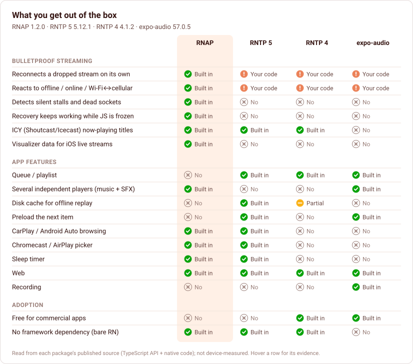
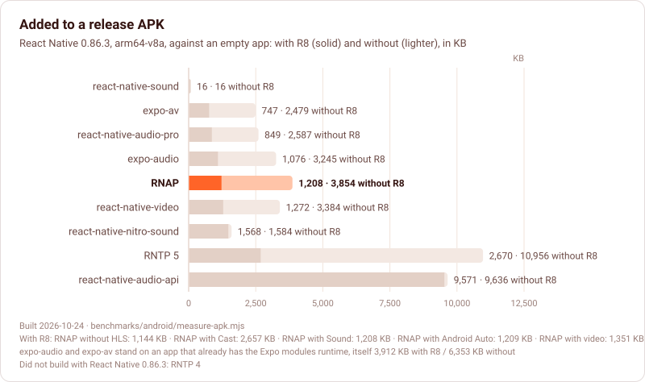
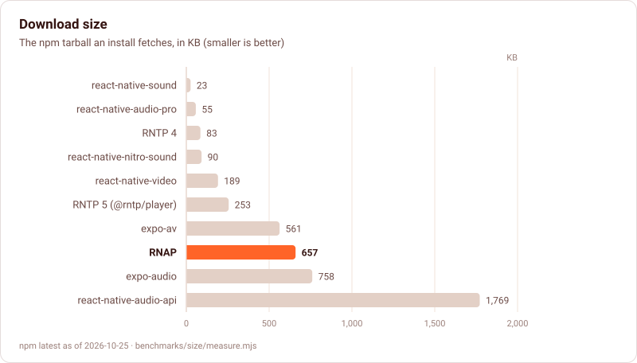
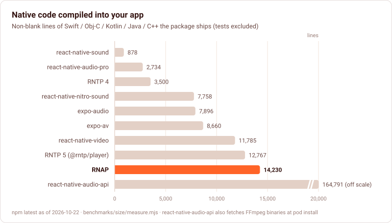
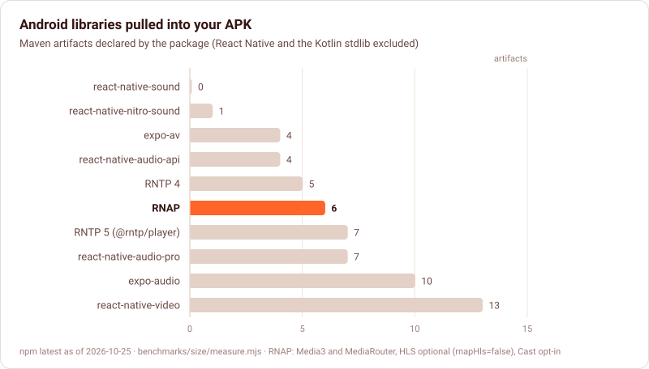
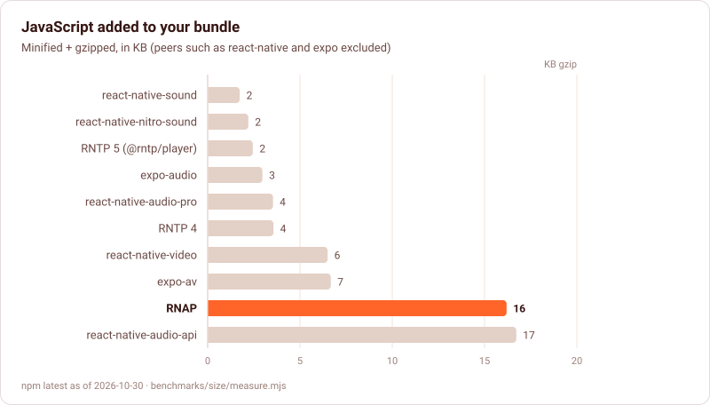
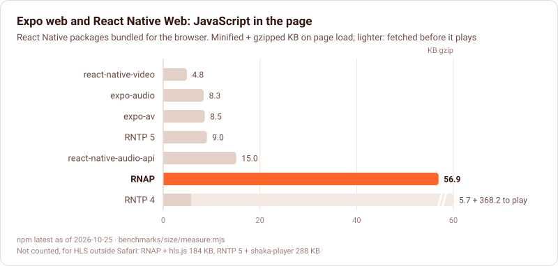
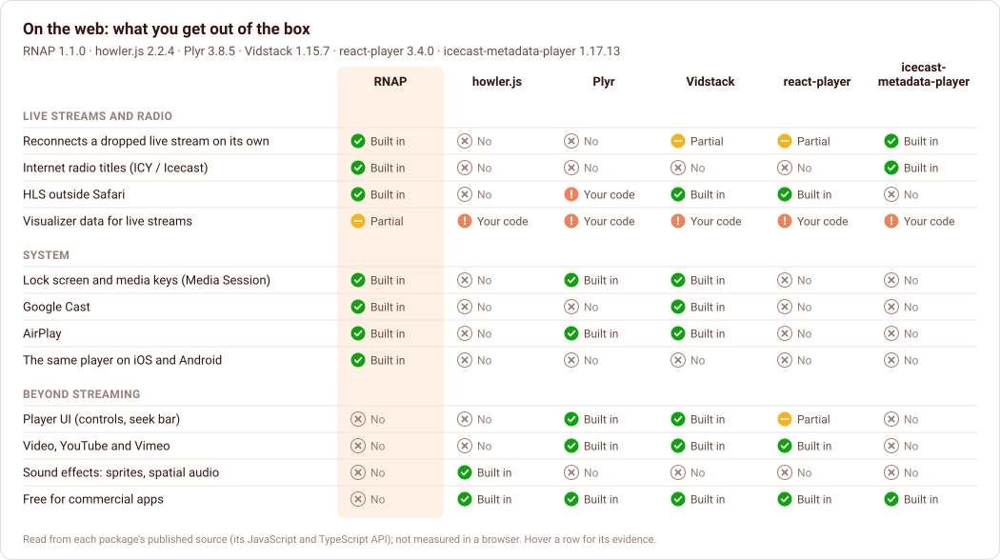
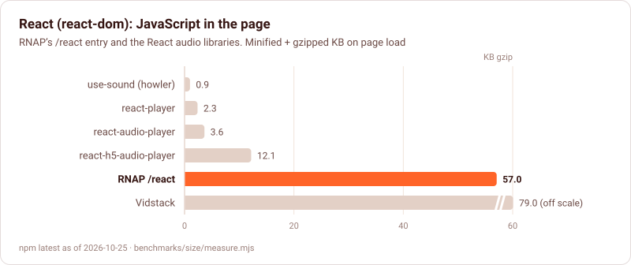
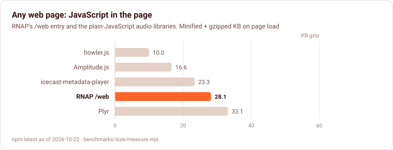

# Comparison & benchmarks

How RNAP compares with the other audio libraries, from what each one actually ships. Each library is compared with its own kind:

- **[Where each library runs](#where-each-library-runs)**: iOS, Android and the kinds of web app; the browser engines are in the [feature matrix](features.md#browser-engines).
- **[iOS and Android](#ios-and-android)**: RNAP against the other React Native audio libraries.
- **[Expo web and React Native Web](#expo-web-and-react-native-web)**: the same React Native packages, bundled for the browser.
- **[React and plain web pages](#react-and-plain-web-pages)**: RNAP's `/react` and `/web` entries against the web audio libraries: React components and hooks, and plain JavaScript.

Every number here comes from a script in [`benchmarks/`](../benchmarks/README.md), so you can re-run it.

> **What this page is not.** The numbers are measured from the published npm packages, not on a phone or in a browser. Runtime benchmarks across libraries (time to first audio, time to recover from a network drop, memory, bridge traffic) need a device lab. Their protocol is in [`benchmarks/README.md`](../benchmarks/README.md#on-device-benchmarks-protocol) and they are not published yet. RNAP's own device measurements are in [Testing](testing.md#results-this-release).

## At a glance

| Where | Compared with | Where RNAP leads | Where RNAP is behind |
|---|---|---|---|
| iOS, Android | RNTP 4 and 5, expo-audio, expo-av, react-native-video, and four more | Recovers a stream with no app code; follows the network; radio titles; a visualizer for iOS live streams; several players; CarPlay, Android Auto and Wear OS browsing from the same catalog as the voice assistants; a sleep timer and fades run by the native engine; adds 1.2 MB to a release APK with R8, against 2.7 MB for RNTP 5 (which always includes Cast; RNAP with Cast: 2.6 MB); no extras to install | Queues, caching; for video, no ads or downloads yet (react-native-video has them), and its FairPlay not yet tried on a device; JS size (6.3 KB, the others 2–7 KB); more native source than RNTP 5 (14.2k lines against 13.2k), though less of it reaches the APK; the licence |
| Expo web, React Native Web | the same packages, on the web | The only one that recovers a stream or reads radio titles in the browser; Cast and AirPlay; nothing to fetch before it plays (RNTP 4 fetches 367 KB of shaka-player) | Page weight (31.5 KB against 4–15 KB): it carries a streaming engine, the others wrap `<audio>` |
| React, plain web pages | howler.js, Plyr, Vidstack, react-player, icecast-metadata-player and others | Recovery, radio titles, Media Session, Cast and AirPlay together, in one library; the same player as on the phone | No player UI of its own (the browser's controls, or yours) and no YouTube or Vimeo embeds; short sounds (the separate `/sound` entry) without sprites or spatial audio; heavier than howler.js (10 KB) |

## Where each library runs

Where a library gives you its API: in a React Native app on iOS and Android, in that app's web build (React Native Web, Expo web), in a React DOM app, or on any page. On the web, what works then depends on the browser's engine: RNAP's is in the [feature matrix](features.md#browser-engines), engine by engine (Chromium, Firefox, Safari, and iPhone and iPad, where every browser is WebKit).

| Library | iOS | Android | React Native Web, Expo web | React DOM | Any web page |
|---|---|---|---|---|---|
| **RNAP** | ✓ | ✓ | ✓ | ✓ (`/react`) | ✓ (`/web`) |
| RNTP 5 | ✓ | ✓ | ✓ (shaka-player for HLS and DASH) | – | – |
| RNTP 4 | ✓ | ✓ | ✓ (shaka-player for everything) | – | – |
| expo-audio | ✓ | ✓ | ✓ | – | – |
| expo-av (deprecated) | ✓ | ✓ | ✓ | – | – |
| react-native-video | ✓ | ✓ | ✓ | – | – |
| react-native-audio-api | ✓ | ✓ | ✓ | – | – |
| react-native-nitro-sound | ✓ | ✓ | ✓ | – | – |
| react-native-audio-pro | ✓ | ✓ | – | – | – |
| react-native-sound | ✓ | ✓ | – | – | – |
| howler.js, Amplitude.js, Plyr, icecast-metadata-player | – | – | – | ✓ (through your own code) | ✓ |
| use-sound, react-h5-audio-player, react-audio-player, react-player | – | – | – | ✓ | – |
| Vidstack | – | – | – | ✓ (`@vidstack/react`) | ✓ (`vidstack`, web components) |

Read from each package's sources (its `.web` files and entry points). RNTP 4.1.2 does not compile against React Native 0.86 ([release APK](#added-to-a-release-apk)).

## iOS and Android

### What you get out of the box

RNAP is the only one of the four that recovers a stream without app code. The others give the app a `retry()` or a fresh `load()` and leave detection, backoff, connectivity and JS-frozen timing to you. That is the gap behind the most common complaint about RNTP: [a Wi-Fi ↔ 4G switch stops the stream for good](https://github.com/doublesymmetry/react-native-track-player/issues/686), and [iOS does not even report the error](https://github.com/doublesymmetry/react-native-track-player/issues/1437).

Where RNAP is behind today: queues, caching and preloading, and a licence that is free for commercial apps. See the [roadmap](roadmap.md).

Moving from one of them? See the migration guides for [react-native-track-player](migrating-from-track-player.md), [expo-audio](migrating-from-expo-audio.md) and [expo-av](migrating-from-expo-av.md).

### Added to a release APK

What an app's users download: each library built into a React Native 0.86 app, in release mode for arm64-v8a, against the same app without it. "With R8" is how a store build ships (`minifyEnabled` and `shrinkResources`); without R8, every class of every dependency stays.

| Library | With R8 | Without R8 | Code (dex) | Native libraries | Resources |
|---|--:|--:|--:|--:|--:|
| **RNAP** | 1,208 KB | 3,854 KB | 867 KB | 92 KB | 242 KB |
| RNAP without HLS (`rnapHls=false`) | 1,144 KB | 3,758 KB | 810 KB | 92 KB | 242 KB |
| RNAP with Cast (`rnapCast=true`) | 2,657 KB | 11,072 KB | 1,228 KB | 102 KB | 1,213 KB |
| RNAP with the Sound API (`rnapSound=true`) | 1,208 KB | 3,854 KB | 874 KB | 92 KB | 242 KB |
| RNAP with Android Auto (`rnapCar=true`) | 1,209 KB | 3,854 KB | 867 KB | 92 KB | 242 KB |
| RNAP with video (`rnapVideo=true`, DASH included) | 1,351 KB | 3,966 KB | 990 KB | 92 KB | 255 KB |
| RNAP with video and its software decoders (`rnapVideoDecoders=true`) | 4,215 KB | 6,830 KB | 1,009 KB | 2,910 KB | 255 KB |
| RNTP 5 (Cast always in) | 2,670 KB | 10,956 KB | 1,306 KB | 55 KB | 1,213 KB |
| react-native-video | 1,272 KB | 3,384 KB | 762 KB | 0 | 487 KB |
| react-native-audio-pro | 849 KB | 2,587 KB | 659 KB | 0 | 184 KB |
| react-native-nitro-sound | 1,568 KB | 1,584 KB | 28 KB | 1,539 KB | 0 |
| react-native-audio-api | 9,571 KB | 9,636 KB | 48 KB | 9,481 KB | 13 KB |
| react-native-sound | 16 KB | 16 KB | 4 KB | 26 KB | 0 |
| Expo modules runtime (`expo` 57.0.31) | 3,912 KB | 6,353 KB | 1,060 KB | 2,138 KB | 554 KB |
| expo-audio (over the runtime) | 1,076 KB | 3,245 KB | 778 KB | 0 | 277 KB |
| expo-av (over the runtime) | 747 KB | 2,479 KB | 526 KB | 94 KB | 117 KB |
| RNTP 4 | — | — | | | |

Built 2026-10-24 (`benchmarks/results/apk.json`); the code, native and resource columns are with R8, as stored in the APK. RNTP 4.1.2 does not compile against React Native 0.86. The Expo rows come from a second app: the same bare app plus the Expo modules runtime. The runtime row is what that runtime adds to the bare app; the expo-audio and expo-av rows are what each adds on top of it. expo-av's prebuilt binary links against older Expo APIs, so its R8 build also needs three `-dontwarn` rules that its package does not ship.

How to read it:

- **R8 is where the size goes.** Media3 is large on disk and mostly unused by any one app: R8 removes two thirds of what the Media3-based players add. Turn it on for release builds; RNAP needs no rules of its own (see [Configuration](configuration.md#release-builds-and-r8)).
- **RNAP is shaped for R8.** It builds ExoPlayer with only the audio and metadata renderers, so the video, subtitle and image code is removed, and Android compiles only its module's C++, not the iOS-only AirPlay button's. Release 1.1.0 added 1,400 KB with R8 and 1.1.1 added 1,176 KB; 1.2.0, with the sleep timer, fades and the browse tree, added 1,192 KB, and the next release adds 1,208 KB. The Sound API and Android Auto cost almost nothing on top (SoundPool and a manifest entry). Video is the one module that brings Media3 code back: the video and text renderers and DASH, 142 KB with R8 (`rnapDash=false` leaves DASH out). Its software decoders are native libraries, 2.8 MB more for one ABI (about 1.2 MB to download), and only for apps that turn them on.
- **Same work, same size.** react-native-audio-pro is smaller with less to do (no HLS, no output picker, no recovery). With Cast in, RNAP and RNTP 5 land within 45 KB of each other: the Cast framework is most of it.
- **Native code that R8 cannot touch:** react-native-audio-api ships FFmpeg and its audio engine as native libraries, and react-native-nitro-sound its C++ through Nitro.
- **Expo modules need the Expo runtime.** An app that does not use Expo yet adds 3,912 KB with R8 for the runtime (its core modules and their C++) before the module itself. An app already on Expo pays only the module: 1,076 KB for expo-audio, 747 KB for expo-av.

### Install size

| Package | Version | Licence | Download | Unpacked | JS (min+gz) | Native code | Android artifacts | Required extras |
|---|---|---|--:|--:|--:|--:|--:|---|
| **RNAP** | 1.2.0 | PolyForm NC | 368 KB | 1,230 KB | 6.3 KB | 14,230 lines (+2,081 opt-in) | 5 (+2 with Cast) | — |
| RNTP 5 (@rntp/player) | 5.12.1 | commercial | 253 KB | 1,211 KB | 2.4 KB | 13,232 lines | 7 | — |
| RNTP 4 | 4.1.2 | Apache-2.0 | 83 KB | 378 KB | 3.5 KB | 3,500 lines | 5 | — |
| expo-audio | 58.0.10 | MIT | 758 KB | 1,313 KB | 2.9 KB | 7,896 lines | 10 | `expo`, `expo-asset` |
| expo-av | 16.0.8 | MIT | 561 KB | 1,268 KB | 6.6 KB | 8,660 lines | 4 | `expo` |
| react-native-audio-pro | 10.1.2 | MIT | 55 KB | 268 KB | 3.5 KB | 2,734 lines | 7 | `zustand` |
| react-native-nitro-sound | 0.2.20 | MIT | 90 KB | 508 KB | 2.2 KB | 7,758 lines | 1 | `react-native-nitro-modules`, `@react-native-community/slider` |
| react-native-video | 6.19.3 | MIT | 189 KB | 937 KB | 6.5 KB | 11,785 lines | 13 | — |
| react-native-audio-api | 0.13.6 | MIT | 1769 KB | 9,243 KB | 16.7 KB | 164,791 lines | 4 | `semver` |
| react-native-sound | 0.13.0 | MIT | 23 KB | 92 KB | 1.7 KB | 878 lines | 0 | — |

Measured 2026-10-22 against the latest npm releases (`benchmarks/results/size.json`). RNAP is packed from this repository, as it would be published. Google Cast is opt-in: its native code and its two Android artifacts are counted apart, because an app without the `cast` option does not compile them.

How to read it:

- **JavaScript is not where the cost is.** Every player adds 2–7 KB of gzipped JS, because they all do their work in native code. RNAP's 6.3 KB is everything its main entry exports: the player, hooks, the sleep timer and fades, the voice catalog and its browse options, the Cast and output functions, and the two buttons (their icons are image assets, not JS). The browser engine is not in it: bundlers load it only on the web. The meaningful costs are the native code and the Android libraries your app compiles.
- **RNAP's native code** (source lines: [what reaches the APK](#added-to-a-release-apk) is the better measure) is 14.2k lines for the engine twins (now with the sleep timer and fades), the iOS stream proxy, the iOS stream visualizer, the media sessions, outputs and the output picker, and the voice catalog with its browse tree for cars and watches, Siri and the assistants. The opt-in parts add 2.1k lines when they are turned on: Google Cast, the Sound API and CarPlay / Android Auto. RNTP 5 is 13.2k. The minimal players (react-native-sound, audio-pro, RNTP 4) are smaller because they do much less: no recovery, no proxy, no visualizer.
- **Android libraries**: RNAP pulls in Media3 (ExoPlayer, session, the OkHttp data source and HLS) and AndroidX MediaRouter (the system output picker). HLS can be left out with `rnapHls=false`; Google Cast adds Media3 Cast and the Cast framework only with `rnapCast`. expo-audio adds DASH, SmoothStreaming and Media3 UI; react-native-video adds IMA ads and RTSP as well.
- **No extras.** RNAP needs nothing beyond React Native: no framework (`expo` is optional, for the config plugin only), no Nitro, no worklets, no state library.
- **Download size** is mostly the compiled JS and the native sources. RNAP ships only what an app uses: the compiled output for every entry (React Native, the web engine, React DOM) with its type declarations, no source maps and no second copy of the sources; the native sources for iOS and Android (Cast, the Sound API, CarPlay / Android Auto and the Siri templates included, compiled only when turned on); the Expo plugin; and the CLI as one minified file (112 KB, the largest single file). Most of the difference with RNTP 5 is the web and the CLI: RNAP carries a complete engine there, the same one as on the phone, which never reaches a native app's bundle.

## Expo web and React Native Web

The same React Native packages, bundled for the browser the way Metro and React Native Web resolve them (their `.web` files). What matters on the web is the JavaScript a page loads.

| Package | On page load | Fetched to play | Lock screen (Media Session) | Recovers a dropped stream | Radio titles | HLS outside Safari |
|---|--:|--:|---|---|---|---|
| **RNAP** | 31.5 KB | — | ✓ | ✓ | ✓ | ✓ with hls.js (the app adds it, 184 KB) |
| RNTP 5 | 9.0 KB | — | ✓ | – (`retry()` for the app) | – | ✓ with shaka-player (288 KB) |
| RNTP 4 | 5.7 KB | 367 KB (shaka-player, for anything) | – | – (`retry()` for the app) | – | ✓ shaka-player |
| expo-audio | 8.3 KB | — | ✓ | – | – | – |
| expo-av | 8.5 KB | — | – | – | – | – |
| react-native-video | 4.8 KB | — | ✓ | – | – | – |
| react-native-audio-api | 15.0 KB | — | – | – | – | – |

Minified and gzipped, with `react`, `react-native-web` and `expo` excluded (every such app has them). Read from each package's web sources.

RNAP is the heaviest page here because it is the only one with a streaming engine on the web: it reads the stream itself (Media Source Extensions), so it can time radio titles to the audio, notice a stall, and reconnect under the same recovery rules as on the phone. The others hand a URL to an `<audio>` element and report what it does. RNTP 4 is light on load and then fetches shaka-player, its web player, before it plays anything. Google Cast, the hls.js glue and the Firefox repackaging load only when they are used (8 KB more).

## React and plain web pages

RNAP's web entries are the same engine with no React Native: `react-native-anything-player/react` for React DOM apps (Vite, Next.js) and `react-native-anything-player/web` for any page. The web audio libraries do different jobs, so the matrix shows what each one is for.

### React (react-dom)

### Any web page

| Library | Version | Licence | On page load | Everything it can load | What it is |
|---|---|---|--:|--:|---|
| **RNAP `/web`** | 1.2.0 | PolyForm NC | 30.0 KB | 37.7 KB | A streaming player: recovery, radio titles, Media Session, Cast, AirPlay |
| **RNAP `/react`** | 1.2.0 | PolyForm NC | 31.5 KB | 39.2 KB | The same, with hooks and the output and Cast buttons |
| howler.js | 2.2.4 | MIT | 10.0 KB | 10.0 KB | Sound effects and short files over Web Audio: sprites, spatial audio |
| use-sound | 5.0.0 | MIT | 0.9 KB | 10.6 KB | A React hook over howler.js, which it loads on first use |
| Amplitude.js | 5.3.2 | MIT | 16.6 KB | 16.6 KB | Playlists and a bring-your-own-HTML player UI |
| react-h5-audio-player | 3.10.2 | MIT | 12.1 KB | 12.1 KB | A player UI around `<audio>` (its CSS not counted) |
| react-audio-player | 0.17.0 | MIT | 3.6 KB | 3.6 KB | A thin React wrapper for `<audio>` |
| Plyr | 3.8.5 | MIT | 33.1 KB | 33.1 KB | A themed audio and video player UI, with YouTube and Vimeo |
| react-player | 3.4.0 | MIT | 3.1 KB | 614 KB | A component that embeds YouTube, Vimeo, HLS, Mux and others, each loaded when used |
| Vidstack | 1.15.7 | MIT | 32.8 KB | 103 KB | A video and audio player UI, with HLS, Cast and AirPlay |
| icecast-metadata-player | 1.17.13 | LGPL-3.0 | 23.3 KB | 238 KB | An Icecast / Shoutcast player with radio titles; WebAssembly decoders for codecs the browser cannot stream |

Minified and gzipped, with `react` and `react-dom` excluded. "On page load" is what a page loads up front; "everything it can load" adds the parts a library fetches with `import()` when a feature is used. (For RNAP that is Google Cast and the MP4 repackaging Firefox needs.)

How to read it:

- **Recovery is the gap.** Of these libraries, only RNAP and icecast-metadata-player reconnect a dropped live stream on their own. Vidstack and react-player get hls.js's fragment retries for HLS; the rest leave it to the app.
- **For internet radio,** icecast-metadata-player is the closest peer: it reads radio titles and reconnects too. RNAP adds Media Session, Cast, AirPlay and a visualizer, and is the same player on iOS and Android.
- **howler.js is smaller** (10 KB) and has sprites and spatial audio. RNAP's short sounds come from a separate entry (`react-native-anything-player/sound`) that a streaming page does not load; howler.js has no streaming recovery, radio titles or Media Session.
- **Plyr and Vidstack are about the same weight on load** (33 KB), and come with a player UI and video. RNAP has no UI beyond its output and Cast buttons: you draw your own controls with its hooks or events.

## Methodology

- `node benchmarks/size/measure.mjs` installs every package from npm, packs this repository as it would be published, and records the tarball and unpacked sizes. It also counts the non-blank native source lines that compile into an app (tests, examples and builds excluded), parses the Maven artifacts from `android/build.gradle`, and bundles each package's JS with esbuild (minified, gzip -9, with React Native, React, Expo and other peer frameworks excluded).
- For the web it bundles each package as an app's production build would: for the browser, code-split, with React (and React Native Web and Expo for the React Native packages) excluded. It records the JS a page loads up front, everything including the chunks loaded with `import()`, and what a package fetches on its own at run time (shaka-player for RNTP).
- `node benchmarks/android/measure-apk.mjs` builds one React Native app in release mode for arm64-v8a, once alone and once per library, with R8 on and off, and records the difference in APK size by part (dex, native libraries, resources). The app's JS does not import the library, so this is the native cost only.
- `node benchmarks/charts/render.mjs` draws the charts on this page from the results.
- The capability matrices (`benchmarks/results/capabilities.json` and `capabilities-web.json`) were read from each package's TypeScript API and sources. Each row records its evidence; hover a row in the chart to see it.
