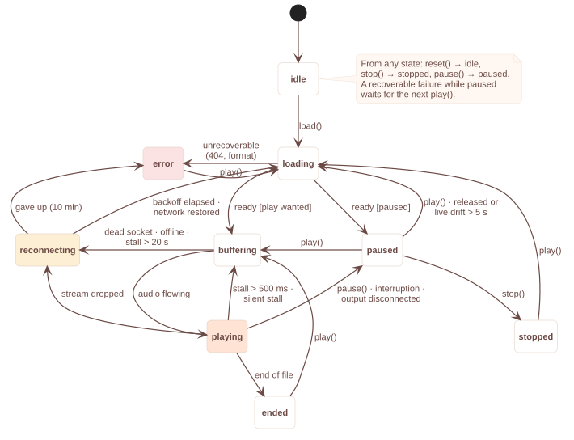

# Playback

## Sources

`load()` accepts a URI string, a `Source` object, or an asset module:

```ts
await player.load('https://example.com/a.mp3');
await player.load(require('./assets/jingle.mp3'));
await player.load({
  uri: 'https://radio.example.com/stream',
  headers: { Authorization: 'Bearer …', 'User-Agent': 'MyApp/1.0' },
  live: true, // optional hint, see below
  metadata: { title: 'My Radio', artist: 'Live', artwork: 'https://…/logo.png' },
});
```

| URI | iOS | Android | Web |
|---|---|---|---|
| `https://…`, `http://…` | ✓ (cleartext needs an ATS exception) | ✓ (cleartext needs a network-security config) | ✓ (an `http` stream on an `https` page is blocked as mixed content) |
| `file:///…` and absolute paths | ✓ | ✓ | – |
| `content://…` | – | ✓ | – |
| `require('./a.mp3')` | ✓ debug (Metro) and release (bundle) | ✓ debug (Metro) and release (raw resource) | – (pass a URL) |
| A `File` / `Blob`, `blob:` and `data:` URLs | – | – | ✓ ([Web](web.md#local-files)) |
| HLS (`.m3u8`) | ✓ | ✓ (disable with `rnapHls=false` in `gradle.properties` to save 64 KB with R8) | ✓ Safari natively; other browsers through [hls.js](web.md#hls) (`configureHls`) |

Formats are whatever the platform decodes: MP3, AAC/AAC+ (ADTS), M4A/MP4, WAV, FLAC (Android; iOS 11+), Opus/Vorbis (Android).

`live: true` is optional — an indefinite duration is detected as live — but it lets live behaviour (fast start, live-edge recovery) apply from the first byte.

`headers` are sent with every request for the source (including reconnects). On iOS they go through the app's own `URLSession`; on Android through Media3's HTTP stack.

## Commands

All commands are applied by native code **in call order** and resolve with the status *after* they were applied. They reject with a [`PlayerError`](errors.md).

| Command | Behaviour |
|---|---|
| `load(source, { autoplay?, startPosition? })` | Opens a source. Resolves when it is ready to play, or when a later `load` replaced it; rejects if it cannot be opened. Keeps the current intent unless `autoplay` is given: a playing player switches sources seamlessly (station switching), a paused one stays paused. |
| `play()` | Starts or resumes. A live stream that was paused for longer than the drift budget (default 5 s) or whose connection was released re-opens at the live edge. A finished file restarts. Rejects with `AUDIO_FOCUS_DENIED` when another app or a call holds audio focus. |
| `pause()` | Pauses. A paused **live** stream releases its network connection after 30 s. |
| `toggle()` | `pause()` if playback is wanted, `play()` otherwise. |
| `stop()` | Pauses and releases network and decoder resources; the source stays loaded and `play()` re-opens it (files restart from the beginning). |
| `reset()` | Unloads the source (`idle`). |
| `seekTo(seconds)` | Seconds, clamped to the duration. Rejects `NOT_SEEKABLE` for live streams. |
| `setVolume(0…1)` | Per-player volume, independent of `setMuted`. |
| `setMuted(bool)` | Mute without losing the volume. |
| `setRate(rate)` | Playback rate (files; live streams will run out of buffer above 1). |
| `fadeTo(volume, seconds)` | Moves the volume to `volume` over `seconds`. Resolves when it gets there. See [Sleep timer and fades](#sleep-timer-and-fades). |
| `sleep({ after, fadeOut? })` | Pauses after `after` seconds; `sleep(null)` cancels. See [Sleep timer and fades](#sleep-timer-and-fades). |
| `setFade({ in?, out? })` | Replaces the fades on play, pause and stop; `setFade(null)` turns them off. |
| `release()` | Stops and frees every native resource. Commands afterwards reject `PLAYER_RELEASED`. |

Rapid sequences are safe: `play(); pause(); play(); pause();` ends paused; `load(A); load(B); load(C);` plays C, and A/B resolve as superseded. Events from A or B that arrive late are dropped natively (each open has a *generation*).

## State model



| `state` | Meaning |
|---|---|
| `idle` | nothing loaded |
| `loading` | a source is being opened (also during a reconnect attempt) |
| `buffering` | playback wanted, audio not flowing (start, stall) |
| `playing` | audio is flowing |
| `paused` | loaded and not playing — by the app/user, or the system (`status.interruption` says which) |
| `stopped` | resources released, source kept |
| `reconnecting` | the connection was lost while playback is wanted; `status.reconnect` has the attempt and next time |
| `ended` | a file played to its end |
| `error` | unrecoverable failure (`status.error`) |

`status.playWhenReady` is the play *intent*: it is `true` while loading, buffering and reconnecting. Stalls shorter than 500 ms are not published (no spinner flicker).

## Progress

```ts
const { position, duration, buffered, bufferedAhead, liveOffset } = player.getProgress();
```

`getProgress()` is a synchronous JSI call that reads a snapshot native code keeps and extrapolates it to "now", so it is cheap enough to call every frame and correct right after JavaScript was frozen in the background. `useProgress(player, intervalMs)` polls it while the app is in the foreground, so a progress bar needs no events.

To follow the audio where JS timers are frozen (an Android app in the background), set `progressInterval`: the player then emits `progress` events from a native timer while playing ([events](events.md)).

```ts
const player = new Player({ progressInterval: 1000 });
player.on('progress', ({ position, liveOffset }) => { /* e.g. switch the lock screen to the next song */ });
```

For live streams `position` is the time played since the stream was (re-)opened, `duration` is `null`, `bufferedAhead` is how much audio is buffered past the playhead, and `liveOffset` is how far behind the live edge playback is, when it can be measured: HLS program dates (`EXT-X-PROGRAM-DATE-TIME`), ExoPlayer's live window, and on iOS any live HTTP stream, from the audio the stream proxy has handed the player. Otherwise it is `null`; use `bufferedAhead`.

## Sleep timer and fades

The sleep timer and every fade run in native code, on the player's own clock. They keep going while JavaScript is frozen in the background, and the screen can be off.

### Sleep timer

```ts
await player.sleep({ after: 30 * 60, fadeOut: 10 }); // pause in 30 min, fading out over the last 10 s
player.status.sleepAt; // epoch ms when it fires, or null
await player.sleep(null); // cancel
```

- `after` is in seconds of wall time. It counts while the player is paused too.
- `fadeOut` lowers the volume over the last seconds before the pause. Without it, the timer uses `fade.out` (below), or no fade.
- When the timer fires, the player pauses as if the user had paused it: a pending system resume (after a call, for example) is cancelled. If the player was not playing, the timer just ends.
- A new `sleep()` replaces the timer. Cancelling it during its fade-out brings the volume back at the same speed.
- The timer keeps its time across reconnects, source changes and Cast handoffs.
- `status.sleepAt` changes when the timer is set, cancelled or fires, and a `sleep` event is emitted when it fires.
- A live stream paused by the timer releases its network connection after 30 s, as after any pause. `play()` re-opens it at the live edge.

`useSleepTimer(player)` returns `{ sleepAt, remaining }`, with `remaining` in whole seconds, counted down while the app is in the foreground:

```tsx
const { remaining } = useSleepTimer(player);
return remaining == null ? null : <Text>Stops in {Math.ceil(remaining / 60)} min</Text>;
```

### Fades on play, pause and stop

Off by default. Durations are in seconds:

```ts
const player = new Player({ fade: { in: 1, out: 2 } });
await player.setFade({ out: 0.5 }); // change them later; setFade(null) turns them off
```

- `in`: `play()`, a resume after an interruption, and a `load()` that starts playback begin silent and fade in once the audio flows. Switching sources while playing does not fade.
- `out`: `pause()` and `stop()` fade out, then pause or stop. `status.playWhenReady` turns `false` at once (the play button changes), while `status.state` stays `playing` until the fade ends.
- `pause()` during a fade-out pauses at once. `play()` during a fade-out cancels it: the audio never stopped.
- A stall, an error, an interruption or a new `load()` during a fade-out ends it at once.
- A fade starts from where the volume is: a pause halfway through a fade-in fades out from there, in proportion.

### `fadeTo`

```ts
await player.fadeTo(0.2, 3); // to 20 % over 3 s
```

`status.volume` is the target from the start. The promise resolves when the volume gets there, or when `setVolume` or another `fadeTo` takes over.

### How fades combine

The volume the platform player gets is the app's volume × the system's ducking × the fades (0 when muted). Fades never change `status.volume`, except `fadeTo`, whose target is the new volume. Ducking, muting and `setVolume` during a fade apply at once and the fade carries on. The volume moves in steps every 50 ms.

On a Cast receiver, fades and `fadeTo` are instant and the sleep timer pauses without a fade-out: the receiver sets its own volume. In a browser tab that is hidden, timers run less often, so fades move in larger steps and the timer can fire late. On iPhone and iPad browsers the system fixes the volume: fades have no effect there, and the sleep timer pauses without one.

## Several players

Players are independent native engines. The lock screen shows the most recently started player with `mediaSession.enabled` (the default). Audio focus is per app on Android: all players share it, and a focus loss pauses every player that does not use `audio.mixWithOthers`.

## Local files

```ts
import { Paths } from 'expo-file-system'; // or react-native-fs, etc.
await player.load(`${Paths.document.uri}episodes/42.mp3`);
```

Local files are never "released" while paused and never reconnect; seeking is exact.
