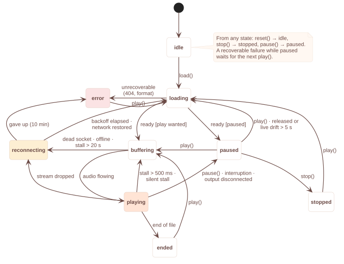

# Playback

## Sources

`load()` accepts a URI string, a `Source` object, or an asset module:

```ts
await player.load('https://example.com/a.mp3');
await player.load(require('./assets/jingle.mp3'));
await player.load({
  uri: 'https://radio.example.com/stream',
  headers: { Authorization: 'Bearer …', 'User-Agent': 'MyApp/1.0' },
  live: true, // optional hint, see below
  metadata: { title: 'My Radio', artist: 'Live', artwork: 'https://…/logo.png' },
});
```

| URI | iOS | Android | Web |
|---|---|---|---|
| `https://…`, `http://…` | ✓ (cleartext needs an ATS exception) | ✓ (cleartext needs a network-security config) | ✓ (an `http` stream on an `https` page is blocked as mixed content) |
| `file:///…` and absolute paths | ✓ | ✓ | – |
| `content://…` | – | ✓ | – |
| `require('./a.mp3')` | ✓ debug (Metro) and release (bundle) | ✓ debug (Metro) and release (raw resource) | – (pass a URL) |
| A `File` / `Blob`, `blob:` and `data:` URLs | – | – | ✓ ([Web](web.md#local-files)) |
| HLS (`.m3u8`) | ✓ | ✓ (disable with `rnapHls=false` in `gradle.properties` to save 64 KB with R8) | ✓ Safari natively; other browsers through [hls.js](web.md#hls) (`configureHls`) |

Formats are whatever the platform decodes: MP3, AAC/AAC+ (ADTS), M4A/MP4, WAV, FLAC (Android; iOS 11+), Opus/Vorbis (Android).

`live: true` is optional — an indefinite duration is detected as live — but it lets live behaviour (fast start, live-edge recovery) apply from the first byte.

`live: false` says the source is a file even when it does not look like one. A server that sends a finite file without a `Content-Length` (chunked transfer, typical of files generated on the fly) looks exactly like a live stream: on iOS the stream proxy would then treat the end of the file as a dropped radio connection and splice a fresh request in, so the file would start over instead of ending. Load such a file with `live: false`: it is never spliced or reported live, and it ends at its end.

`headers` are sent with every request for the source (including reconnects). On iOS they go through the app's own `URLSession`; on Android through Media3's HTTP stack.

## Commands

All commands are applied by native code **in call order** and resolve with the status *after* they were applied. They reject with a [`PlayerError`](errors.md).

| Command | Behaviour |
|---|---|
| `load(source, { autoplay?, startPosition? })` | Opens a source. Resolves when it is ready to play, or when a later `load` replaced it; rejects if it cannot be opened. Keeps the current intent unless `autoplay` is given: a playing player switches sources seamlessly (station switching), a paused one stays paused. |
| `play()` | Starts or resumes. A live stream that was paused for longer than the drift budget (default 5 s) or whose connection was released re-opens at the live edge. A finished file restarts. Rejects with `AUDIO_FOCUS_DENIED` when another app or a call holds audio focus. |
| `pause()` | Pauses. A paused **live** stream releases its network connection after 30 s. |
| `toggle()` | `pause()` if playback is wanted, `play()` otherwise. |
| `stop()` | Pauses and releases network and decoder resources; the source stays loaded and `play()` re-opens it (files restart from the beginning). |
| `reset()` | Unloads the source (`idle`). |
| `seekTo(seconds)` | Seconds, clamped to the duration. Rejects `NOT_SEEKABLE` for live streams. |
| `setVolume(0…1)` | Per-player volume, independent of `setMuted`. |
| `setMuted(bool)` | Mute without losing the volume. |
| `setRate(rate)` | Playback rate (files; live streams will run out of buffer above 1). |
| `fadeTo(volume, seconds)` | Moves the volume to `volume` over `seconds`. Resolves when it gets there. See [Sleep timer and fades](#sleep-timer-and-fades). |
| `sleep({ after, fadeOut? })` | Pauses after `after` seconds; `sleep(null)` cancels. See [Sleep timer and fades](#sleep-timer-and-fades). |
| `setFade({ in?, out? })` | Replaces the fades on play, pause and stop; `setFade(null)` turns them off. |
| `release()` | Stops and frees every native resource. Commands afterwards reject `PLAYER_RELEASED`. |

Rapid sequences are safe: `play(); pause(); play(); pause();` ends paused; `load(A); load(B); load(C);` plays C, and A/B resolve as superseded. Events from A or B that arrive late are dropped natively (each open has a *generation*).

## State model



| `state` | Meaning |
|---|---|
| `idle` | nothing loaded |
| `loading` | a source is being opened (also during a reconnect attempt) |
| `buffering` | playback wanted, audio not flowing (start, stall) |
| `playing` | audio is flowing |
| `paused` | loaded and not playing — by the app/user, or the system (`status.interruption` says which) |
| `stopped` | resources released, source kept |
| `reconnecting` | the connection was lost while playback is wanted; `status.reconnect` has the attempt and next time |
| `ended` | a file played to its end |
| `error` | unrecoverable failure (`status.error`) |

`status.playWhenReady` is the play *intent*: it is `true` while loading, buffering and reconnecting. Stalls shorter than 500 ms are not published (no spinner flicker).

## Progress

```ts
const { position, duration, buffered, bufferedAhead, liveOffset } = player.getProgress();
```

`getProgress()` is a synchronous JSI call that reads a snapshot native code keeps and extrapolates it to "now", so it is cheap enough to call every frame and correct right after JavaScript was frozen in the background. `useProgress(player, intervalMs)` polls it while the app is in the foreground, so a progress bar needs no events.

To follow the audio where JS timers are frozen (an Android app in the background), set `progressInterval`: the player then emits `progress` events from a native timer while playing ([events](events.md)).

```ts
const player = new Player({ progressInterval: 1000 });
player.on('progress', ({ position, liveOffset }) => { /* e.g. switch the lock screen to the next song */ });
```

For live streams `position` is the time played since the stream was (re-)opened, `duration` is `null`, and `bufferedAhead` is how much is buffered past the playhead. `liveOffset` is how far what is heard trails the live point, in seconds: the whole delay (the server's burst, the buffer, the decoder), so it does not saw-tooth as chunks arrive, it grows while paused or stalled, and it carries on across a lined-up quality switch. A stream with a clock reports its own reading: HLS program dates (`EXT-X-PROGRAM-DATE-TIME`), a DASH or ExoPlayer live window. A progressive live stream (ICY / Icecast, plain HTTP, a remuxed MPEG-TS channel) is measured from what has been received against the device's clock. It is `null` for a file, on Cast, and on a browser's plain `<audio>` element (a stream without CORS); use `bufferedAhead` there.

`liveOffsetSettled` turns `true` once `liveOffset` has held steady for 3 s, the connection's burst has arrived, so a delay shown to the user ("12 s behind live") or lyrics placed against it do not move. It is `false` again after a `discontinuity` or a new load. `programDate` is the epoch milliseconds the stream's own clock gives what plays now (HLS program dates, DASH), `null` without one.

```ts
const { liveOffset, liveOffsetSettled } = player.getProgress();
if (liveOffsetSettled) showDelay(Math.round(liveOffset!));
```

## Sleep timer and fades

The sleep timer and every fade run in native code, on the player's own clock. They keep going while JavaScript is frozen in the background, and the screen can be off.

### Sleep timer

```ts
await player.sleep({ after: 30 * 60, fadeOut: 10 }); // pause in 30 min, fading out over the last 10 s
player.status.sleepAt; // epoch ms when it fires, or null
await player.sleep(null); // cancel
```

- `after` is in seconds of wall time. It counts while the player is paused too.
- `fadeOut` lowers the volume over the last seconds before the pause. Without it, the timer uses `fade.out` (below), or no fade.
- When the timer fires, the player pauses as if the user had paused it: a pending system resume (after a call, for example) is cancelled. If the player was not playing, the timer just ends.
- A new `sleep()` replaces the timer. Cancelling it during its fade-out brings the volume back at the same speed.
- The timer keeps its time across reconnects, source changes and Cast handoffs.
- Timer and fade durations (`after`, `fadeOut`, `fade.in`, `fade.out`, `fadeTo` seconds) go up to 24 h; a longer one rejects with `INVALID_ARGUMENT`.
- `status.sleepAt` changes when the timer is set, cancelled or fires, and a `sleep` event is emitted when it fires.
- A live stream paused by the timer releases its network connection after 30 s, as after any pause. `play()` re-opens it at the live edge.
- While casting, the timer runs on the phone, which pauses the receiver when it fires. iOS suspends an app in the background that is not playing audio itself, and a casting app plays none: with the phone locked, the timer may fire late, or not until the app runs again. The receiver itself runs no timer.

`useSleepTimer(player)` returns `{ sleepAt, remaining }`, with `remaining` in whole seconds, counted down while the app is in the foreground:

```tsx
const { remaining } = useSleepTimer(player);
return remaining == null ? null : <Text>Stops in {Math.ceil(remaining / 60)} min</Text>;
```

### Fades on play, pause and stop

Off by default. Durations are in seconds:

```ts
const player = new Player({ fade: { in: 1, out: 2 } });
await player.setFade({ out: 0.5 }); // change them later; setFade(null) turns them off
```

- `in`: `play()`, a resume after an interruption, and a `load()` that starts playback begin silent and fade in once the audio flows. Switching sources while playing does not fade.
- `out`: `pause()` and `stop()` fade out, then pause or stop. `status.playWhenReady` turns `false` at once (the play button changes), while `status.state` stays `playing` until the fade ends.
- `pause()` during a fade-out pauses at once. `play()` during a fade-out cancels it: the audio never stopped.
- A stall, an error, an interruption or a new `load()` during a fade-out ends it at once.
- A fade starts from where the volume is: a pause halfway through a fade-in fades out from there, in proportion.

### `fadeTo`

```ts
await player.fadeTo(0.2, 3); // to 20 % over 3 s
```

`status.volume` is the target from the start. The promise resolves when the volume gets there, or when `setVolume` or another `fadeTo` takes over.

### How fades combine

The volume the platform player gets is the app's volume × the system's ducking × the fades (0 when muted). Fades never change `status.volume`, except `fadeTo`, whose target is the new volume. Ducking, muting and `setVolume` during a fade apply at once and the fade carries on. The volume moves in steps every 50 ms.

On a Cast receiver, fades and `fadeTo` are instant and the sleep timer pauses without a fade-out: the receiver sets its own volume. In a browser tab that is hidden, timers run less often, so fades move in larger steps and the timer can fire late. On iPhone and iPad browsers the system fixes the volume: fades have no effect there, and the sleep timer pauses without one.

## Qualities

Separate files of one sound, one per bitrate, are switched by RNAP behind what is heard, with no gap: give them as `renditions` (an audio player's are all sound; `height` and `audioOnly` mean nothing there).

```ts
await player.load(
  {
    renditions: [
      { id: '64k', uri: 'https://cdn.example/ep1-64.m4a', bitrate: 64_000 },
      { id: '192k', uri: 'https://cdn.example/ep1-192.m4a', bitrate: 192_000 },
      { id: '320k', uri: 'https://cdn.example/ep1-320.m4a', bitrate: 320_000 },
    ],
  },
  { quality: '320k' } // from the first byte; 'auto' (the default) follows the bandwidth
);
await player.selectQuality('192k'); // switches without a gap, and holds for the next loads
```

`status.qualities` lists them, `status.quality` is the one playing and `status.selectedQuality` the pick (`null`: automatic). Automatic starts at the highest (a sound's bitrates are small), or for a file at what the last bandwidth reading fits; it steps down on stalls and on a bandwidth that stays too low, and up after 30 s of headroom. Where nothing measures headroom (a live stream arrives at its own bitrate; Safari and Firefox read no bandwidth for a file), it tries one step up after two minutes without a stall. The background never changes it. A pick holds across loads by `id` (give each episode's files the same ids), and a switch that fails is a non-fatal `QUALITY_SWITCH_FAILED` error while the current file plays on. An HLS or DASH source's own variants are left to the platform on an audio player.

### Live renditions

One station's mounts at several bitrates (Icecast's `/64`, `/192`, `/320`) are renditions of one live source:

```ts
await player.load({
  live: true,
  renditions: [
    { id: '64', uri: 'https://radio.example/64', bitrate: 64_000 },
    { id: '192', uri: 'https://radio.example/192', bitrate: 192_000 },
    { id: '320', uri: 'https://radio.example/320', bitrate: 320_000 },
  ],
});
```

Each connection to a mount starts with the server's burst of recent audio, and the burst is a byte count, so a lower bitrate starts further behind live: Icecast's default 64 KiB is 1.6 s at 320 kbps and 8 s at 64 kbps. Played as it arrives, a switch from 320 to 64 kbps would repeat those seconds, and back again would skip them. RNAP lines the new connection up with what is heard before it takes over. It waits for the new connection's burst to arrive, maps the two connections' timelines onto each other by their live edges, then plays the new one silently: held until the old one catches up, moved forward within what it holds, or run faster or slower, until it plays what is heard. The switch is then a change of volume, with no repeat and no skip. It takes a few seconds, longer when the new connection starts far ahead: up to 30 s, the difference between the two bursts.

When it cannot line them up, what happens depends on why it was switching. A switch that has to happen (automatic quality stepping down because the current connection stalls) switches anyway and reports a [`discontinuity`](events.md#events) with `reason: 'switch'` and, when known, `jump`: the seconds skipped (+) or heard again (−). A switch that can wait (`selectQuality`, a step up) is refused when its new connection's burst never settles, it never starts playing, a connection is being replaced, or the alignment would take more than 30 s: the current quality plays on, a non-fatal `QUALITY_SWITCH_FAILED` error says why, and that rendition sits out a minute. A station a browser plays on its plain `<audio>` element (no CORS) can never be lined up, so its switches always go ahead, with a `discontinuity`.

Positions go on across a live switch: `position` does not restart with the new connection, and neither does `liveOffset`. A switch that was lined up reports no `discontinuity`, so an app that keeps its own place in the station's timeline (a song's progress, lyrics) should place it again on `discontinuity`, not on every change of `quality`. The title playing is told again when the new connection takes over, if it changed.

| Measured (`scripts/align-measure`, the test station's 320, 192 and 64 kbps mounts with Icecast's burst, five switches each) | Before | Now |
|---|---|---|
| Android (emulator) | −13.2 s to +6.6 s | aligned, within 0.06 s |
| Chromium (Playwright; also through Expo web) | the same | aligned, within 0.08 s |
| Firefox (Playwright; also through Expo web) | the same | aligned, within 0.13 s |
| Safari (Playwright WebKit) | the same | aligned, within 0.06 s |

A minus sign is audio heard twice, a plus sign audio skipped. The recordings are of what the device played. How the new connection is brought into line depends on the platform. Android runs it faster or holds it. Chromium and Firefox move it within what it has received, then hold it (Firefox plays it at −80 dB, not muted: it stops a silent element's output, and its clock slips when the element is heard again). WebKit runs it faster: an element moved there is paused again, so its switches take about 10 s. On iOS, AVPlayer cannot run a live stream faster, so the stream proxy drops the start of the new connection's burst before AVPlayer reads it, then holds it. iOS is written, and its aligner and burst gate are tested, but it has not been recorded yet. In a browser, the station must send CORS headers so that RNAP reads the stream ([what to send](web.md#what-the-stream-server-must-send)). A station played on the plain `<audio>` element cannot be lined up (a paused element stops loading, and what it has loaded moves in steps of seconds).

HLS and DASH renditions are lined up by their program dates (`EXT-X-PROGRAM-DATE-TIME`, a DASH presentation's clock): each says which moment of the station its playhead is at, so the mapping is known as soon as the new one is ready, with no burst to wait for. The new one is moved to what is heard (a seek within its live window), held, and started, as above; separate playlists with different segment lengths or start points line up the same way, audio or video. HLS or DASH without program dates, or renditions of different kinds (an Icecast mount and an HLS stream), switch at once, as before, whatever the reason.

| Measured (the test station's program as live HLS of packed MP3 with program dates, 2, 4 and 6 s segments; five switches each) | Before | Now |
|---|---|---|
| Chromium, hls.js (Playwright) | −15.7 s to +16.9 s | aligned, within 0.015 s |
| Firefox, hls.js (Playwright) | −18.5 s to +17.1 s | aligned, within 0.04 s |
| WebKit, hls.js (Playwright) | −13.8 s to +15.2 s | aligned, within 0.05 s |
| Android (emulator, ExoPlayer) | not recorded | aligned, within 0.22 s |

On Android the residual is ExoPlayer's own: it plays packed-MP3 segments with jumps of its own at segment boundaries (up to 0.5 s, once 6 s, with no switch near), so its positions are that coarse. Safari's own HLS player (macOS, iOS) and AVPlayer on iOS are written to the same plan (a seek, then held) but not recorded yet. React Native Web plays HLS through hls.js too, once the app registers it ([HLS](web.md#hls)).

## Several players

Players are independent native engines. The lock screen shows the most recently started player with `mediaSession.enabled` (the default). Audio focus is per app on Android: all players share it, and a focus loss pauses every player that does not use `audio.mixWithOthers`.

## Local files

```ts
import { Paths } from 'expo-file-system'; // or react-native-fs, etc.
await player.load(`${Paths.document.uri}episodes/42.mp3`);
```

Local files are never "released" while paused and never reconnect; seeking is exact.
